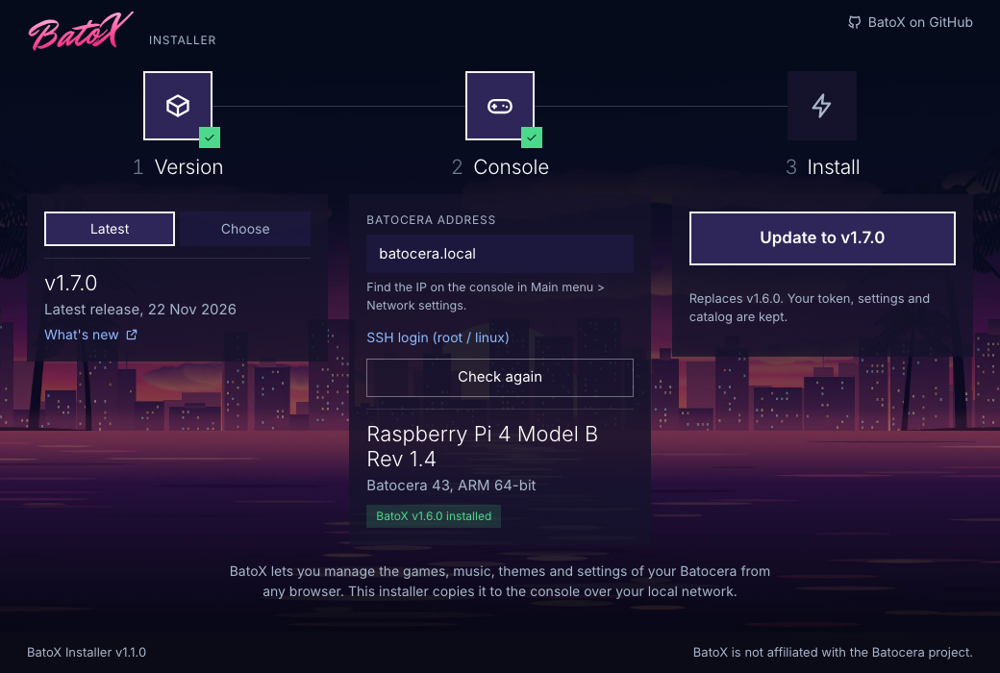
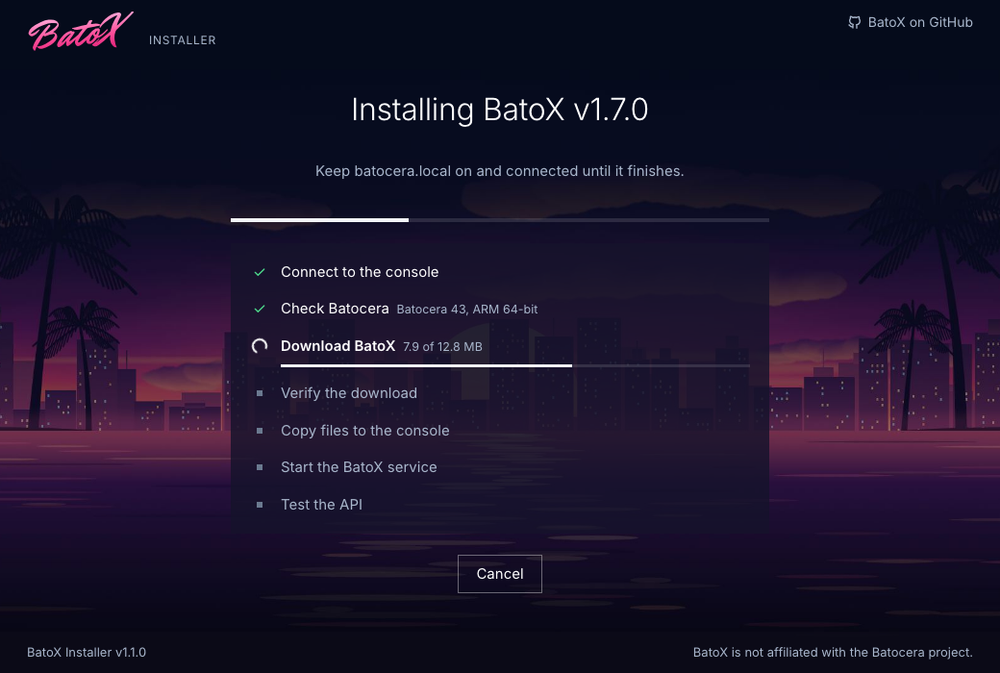
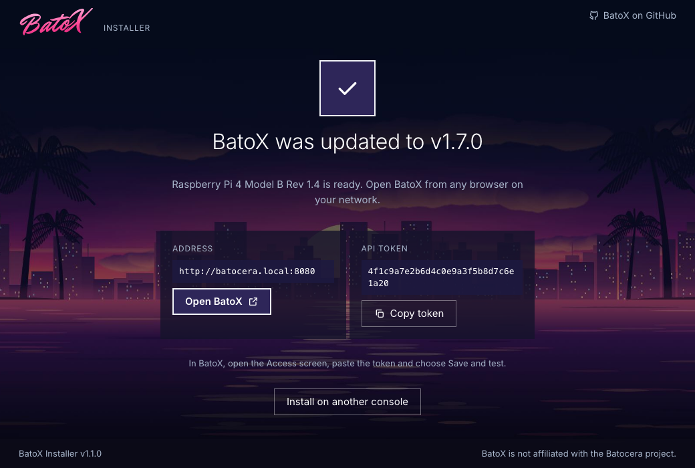

<p align="center">
  <picture>
    <source media="(prefers-color-scheme: dark)" srcset="docs/assets/batox-logo-dark.svg">
    
  </picture>
</p>

<h1 align="center">BatoX Installer</h1>

<p align="center">
  <strong>Install <a href="https://github.com/monteirohat/BatoX">BatoX</a> on your Batocera console in three clicks. No terminal needed.</strong>
</p>

<p align="center">
  <a href="https://github.com/monteirohat/BatoX_Installer/actions/workflows/ci.yml"></a>
  <a href="https://github.com/monteirohat/BatoX_Installer/releases"></a>
  <a href="LICENSE"></a>
</p>

---

BatoX is a web app that manages a Batocera console from any browser. Installing it by hand
means SSH, `scp` and service commands. The BatoX Installer does all of that for you, in the
style of [balenaEtcher](https://etcher.balena.io): pick a version, point it at your console,
and click **Install**.

<p align="center">
  
</p>

## Download

Get the installer for your computer from the
[latest release](https://github.com/monteirohat/BatoX_Installer/releases/latest):

| System | File |
|---|---|
| Windows | `BatoX-Installer-<version>-win-x64.exe` (setup) or the portable `.exe` |
| macOS | `BatoX-Installer-<version>-mac-arm64.dmg` (Apple Silicon) or `-mac-x64.dmg` (Intel) |
| Linux | `BatoX-Installer-<version>-linux-x64.AppImage` or the `.deb` package |

The builds are not code-signed yet, so the first launch shows a warning:

- **Windows:** SmartScreen says "Windows protected your PC". Choose **More info**, then **Run anyway**.
- **macOS:** drag the app to Applications and open it. macOS says it "Not Opened" because Apple
  could not check it: choose **Done**, then open **System Settings > Privacy & Security**, scroll
  down and choose **Open Anyway** next to "BatoX Installer". Choose the `mac-arm64` file on a Mac
  with Apple silicon (M1 and later) and `mac-x64` on an Intel Mac.
- **macOS, version 1.1.0:** it says the app "is damaged" (that build wasn't signed at all). Drag it
  to Applications, then in Terminal run
  `xattr -cr "/Applications/BatoX Installer.app" && codesign --force --deep --sign - "/Applications/BatoX Installer.app"`,
  or get a later version.
- **Linux (AppImage):** make it executable first: `chmod +x BatoX-Installer-*.AppImage`.

## How to use

1. **Version.** The latest BatoX release is selected. Choose **Choose** to pick an older
   release, or type a version such as `v1.0.0`.
2. **Console.** Enter the address of your Batocera machine: `batocera.local`, or its IP
   address (on the console: **Main menu > Network settings**). Click **Check console**. The
   installer connects over SSH and shows the board, the Batocera version and whether BatoX is
   already installed. The default Batocera login (`root` / `linux`) is used; change it under
   **SSH login** if you set another password.
3. **Install.** Click **Install** (or **Update**, if an older BatoX is installed).

<p align="center">
  
  
</p>

At the end, the installer shows the BatoX address and the API token. Open BatoX, go to the
**Access** screen, paste the token and choose **Save and test**.

## What it does

On **Check console**, the installer connects over SSH and confirms that the machine runs
Batocera v38 or newer on a supported processor (64-bit ARM such as the Raspberry Pi 4/5, or
x86_64).

On **Install**, it:

1. downloads the BatoX release files for the console's processor from GitHub, and caches them;
2. verifies them against the release's `SHA256SUMS`;
3. migrates an existing **MyMine** install (BatoX's former name), keeping its token and catalog;
4. copies the binary and the service script to the console, keeping an existing `config.json`;
5. enables and starts the `batox` service and checks that the API answers;
6. reads the API token.

Updating keeps the token, the settings and the game catalog. It is the same procedure as
`make deploy` in the BatoX repository.

## Privacy and security

- The SSH password is only used for the connection. It is never saved; the address, user and
  port are remembered for convenience.
- The installer only talks to GitHub (to download releases) and to the console you enter.
- The interface runs isolated from the system (Electron context isolation and sandbox) and can
  only call the installer's own functions.
- The console's SSH host key is not verified, as with a first `ssh` connection. Use the
  installer on your home network.

## Building from source

Requirements: [Node.js 20+](https://nodejs.org).

```bash
git clone https://github.com/monteirohat/BatoX_Installer.git
cd BatoX_Installer
npm install
npm run dev          # development, with live reload of the interface
npm run dist         # installers for the current system, in release/
```

Other scripts: `npm run typecheck`, `npm run build`, `npm start` (build and run),
`npm run dist:linux`, `dist:win` and `dist:mac`.

### Project layout

```
src/
  main/        Electron main process: window, IPC, GitHub, download, SSH, installation
  preload/     the bridge that exposes window.batox to the interface
  shared/      types shared by both sides (the IPC contract)
  renderer/    React interface: three steps, progress and result screens
build/         app icon used by electron-builder
```

### Tech stack

The same core stack as balenaEtcher: **Electron**, **React** and **TypeScript**, packaged with
**electron-builder**. The interface is built with **Vite**, and SSH runs on
[ssh2](https://github.com/mscdex/ssh2), a pure JavaScript client, so nothing needs to be
installed on the user's computer.

### Releasing

Update [CHANGELOG.md](CHANGELOG.md), then push a tag:

```bash
git tag v1.0.0
git push origin v1.0.0
```

The release workflow builds the Windows, macOS and Linux installers and attaches them to the
GitHub release.

## License

[MIT](LICENSE). BatoX and the BatoX Installer are independent projects, not affiliated with or
endorsed by the Batocera project.
